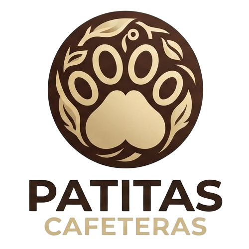

<p align="center">
  
</p>

# 🐾 Patitas Cafeteras – API REST de Turnos

**Taller Evaluativo Final: Arquitectura Cliente-Servidor**
Programa: Profesional en Ingeniería de Software · CIAF
Asignatura: Arquitectura de Software · Grupo 2 (martes)

API REST construida con **Node.js y Express**, organizada por capas (`routes`, `controllers`, `services`), con manejo de códigos HTTP (200, 201, 400 y 404) y una regla de negocio parametrizada por el valor **N** del equipo. Incluye una interfaz web para registrar turnos y probar la API.

---

## 👥 Integrantes

Ordenados alfabéticamente por apellido, con su número en el listado oficial de asistencia (Arquitectura de software – Grupo 2 martes):

| Orden | Nombre completo | N.º de lista oficial |
|:-----:|-----------------|:--------------------:|
| 1 | Arenas Villa Juan Camilo | 1 |
| 2 | Bedoya Calderon Bryan | 2 |
| 3 | Patiño Jimenez Andres Felipe | 9 |

## 🔢 Valor de N y porcentaje de recargo

- El primer integrante en el orden alfabético es **Arenas Villa Juan Camilo**, que ocupa el puesto **#1** en la lista oficial.
- Por tanto, **N = 1**.
- Porcentaje de recargo: `porcentajeRecargo = N × 2% = 1 × 2% = 2%`

**Fórmula aplicada en `services/turnos.service.js`:**

```
Si prioritario === true:
    totalPagar = precioBase + (precioBase × porcentajeRecargo / 100)
Si prioritario es false o no se envía:
    totalPagar = precioBase
```

**Ejemplo real:** precio base de 50.000 con atención prioritaria → 50.000 + (50.000 × 2 / 100) = **51.000**.

---

## 🏪 Negocio elegido

**Patitas Cafeteras** es una peluquería y spa canino inspirada en el Eje Cafetero. Su actividad principal es el cuidado estético y la higiene de perros: baño, corte, spa completo y desparasitación. La atención funciona por turnos; el cliente reserva una fecha y hora para su mascota.

**Atención prioritaria:** significa atención inmediata, sin esperar la fila (por ejemplo, un perro que llega muy sucio o con el pelo enredado antes de un evento). Este servicio tiene un recargo del 2 % (N × 2 %).

### Datos que requiere un turno

| Campo | Tipo | Regla |
|-------|------|-------|
| `nombreCliente` | texto | Obligatorio |
| `nombreMascota` | texto | Obligatorio |
| `tipoServicio` | texto | Obligatorio (baño, corte, spa completo, desparasitación…) |
| `fechaHora` | fecha ISO | Obligatoria y válida |
| `precioBase` | número | Obligatorio y mayor que 0 |
| `prioritario` | booleano | Opcional (por defecto `false`) |
| `id`, `porcentajeRecargo`, `totalPagar` | calculados | Los genera el servidor |

---

## 🏗️ Arquitectura por capas

```
Patitas-Cafeteras/
├── index.js                        # Inicializa Express, middlewares, rutas y levanta el servidor
├── routes/
│   └── turnos.routes.js            # Solo define endpoints y los asocia a su controlador
├── controllers/
│   └── turnos.controller.js        # Gestiona req/res, valida datos y asigna códigos HTTP
├── services/
│   └── turnos.service.js           # Lógica de negocio, cálculo con N y datos en memoria
├── public/                         # Interfaz web (HTML, CSS y JS)
├── package.json
├── .gitignore                      # Excluye node_modules
└── README.md
```

Los datos se almacenan en un **arreglo en memoria** durante la ejecución (sin base de datos externa).

## 🚀 Cómo ejecutarlo

```bash
git clone https://github.com/JuanCamilo620/Patitas-Cafeteras.git
cd Patitas-Cafeteras
npm install
npm start
```

Abrir en el navegador: **http://localhost:3000** (interfaz web y laboratorio de pruebas).

## 📡 Endpoints

| Método | Ruta | Descripción | Códigos |
|--------|------|-------------|---------|
| GET | `/api/turnos` | Lista todos los turnos | 200 |
| GET | `/api/turnos/:id` | Obtiene un turno por id | 200, 404 |
| POST | `/api/turnos` | Registra un turno y calcula la tarifa | 201, 400 |
| GET | `/api/turnos/config` | (Extra) Devuelve N y el porcentaje de recargo | 200 |

---

## 🧪 Pruebas del endpoint `POST /api/turnos`

### ✅ Caso exitoso → 201 Created

**Petición:**

```bash
curl -X POST http://localhost:3000/api/turnos \
  -H "Content-Type: application/json" \
  -d '{
    "nombreCliente": "Valentina Ospina",
    "nombreMascota": "Rocky",
    "tipoServicio": "Spa completo",
    "fechaHora": "2026-12-05T15:30:00",
    "precioBase": 50000,
    "prioritario": true
  }'
```

**Resultado obtenido (HTTP 201):**

```json
{
  "id": 3,
  "nombreCliente": "Valentina Ospina",
  "nombreMascota": "Rocky",
  "tipoServicio": "Spa completo",
  "fechaHora": "2026-12-05T15:30:00.000-05:00",
  "precioBase": 50000,
  "prioritario": true,
  "porcentajeRecargo": 2,
  "totalPagar": 51000
}
```

> El recargo del 2 % (N = 1) se aplicó porque `prioritario` es `true`: 50.000 + 50.000 × 2/100 = 51.000.
> Las fechas se interpretan y se guardan en **hora de Colombia (UTC-5)**: si se envía `2026-12-05T15:30:00` sin zona horaria, se almacena como `2026-12-05T15:30:00.000-05:00`.

### ❌ Caso de error de validación → 400 Bad Request

**Petición:**

```bash
curl -X POST http://localhost:3000/api/turnos \
  -H "Content-Type: application/json" \
  -d '{
    "nombreCliente": "",
    "nombreMascota": "Rocky",
    "tipoServicio": "Baño",
    "fechaHora": "no-es-una-fecha",
    "precioBase": -5000
  }'
```

**Resultado obtenido (HTTP 400):**

```json
{
  "error": "Datos de entrada inválidos",
  "detalles": [
    "nombreCliente es obligatorio y debe ser texto",
    "fechaHora debe ser una fecha válida en formato ISO (ej: 2026-12-01T10:30:00)",
    "precioBase debe ser mayor que 0"
  ]
}
```

### 🔎 Otros casos verificados

| Prueba | Código | Resultado |
|--------|:------:|-----------|
| `GET /api/turnos` | 200 | Lista completa de turnos |
| `GET /api/turnos/1` | 200 | Turno con id 1 |
| `POST` sin `prioritario` (precio 30.000) | 201 | `porcentajeRecargo: 0`, `totalPagar: 30000` |
| `POST` con `precioBase: 0` | 400 | `"precioBase debe ser mayor que 0"` |
| `GET /api/turnos/999` | 404 | `{ "error": "No existe un turno con id 999" }` |

Las pruebas con `curl` se pueden repetir con el script `pruebas.sh` (el servidor debe estar encendido).
